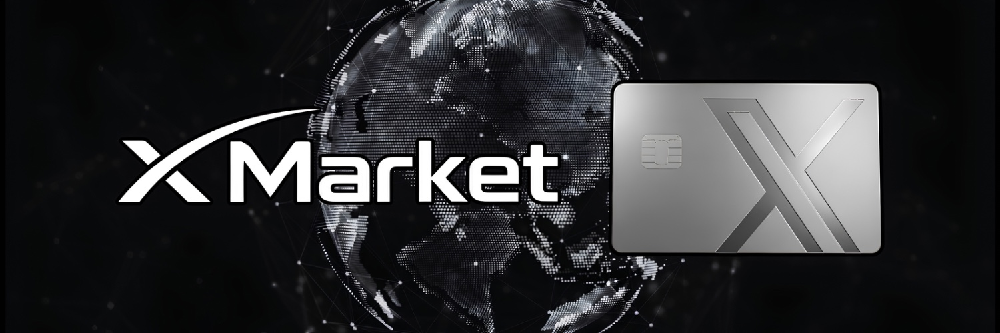

# X MARKET

### DISCOVER. CONNECT. TRADE.

**An independent concept for the next generation of social commerce.**

[View interactive concept](prototype/index.html) · [Vision](docs/vision.md) · [Roadmap](docs/roadmap.md) · [Token concept](docs/token-concept.md)

> **CONCEPT / NOT AN OFFICIAL X PRODUCT** — X Market is an independent, early-stage creative concept inspired by social commerce. It is not affiliated with, endorsed by, or integrated with X, xAI, Grok, Elon Musk, or Amazon. No marketplace, payment rails, AI integrations, or token utility are live. The prototype contains fictional sample listings and simulated interactions.

## The idea

Shopping meets conversation. Imagine discovering products through creators and communities, comparing options with AI assistance, and moving from inspiration to checkout without losing the social experience.

**X Market** explores that future through a visual proof of concept. The experience below is a static, local prototype—not a functioning marketplace.

## Explore the prototype

Open [`prototype/index.html`](prototype/index.html) in a browser. No installation, account, wallet, backend, or API key required.

The prototype includes:
- Responsive storefront with sample products and creator-inspired discovery
- Functional local category filters and search
- Interactive product detail modal and demo-only cart
- A visual AI-assistant concept panel (scripted responses, not actual AI)
- Clear demo labels throughout

## Proposed product pillars

| Pillar | Possibility | Current status |
| --- | --- | --- |
| Social discovery | Shop through creator-led feeds and communities | Concept only |
| AI-assisted shopping | Conversational product search and comparisons | Scripted UI demonstration |
| Merchant storefronts | Simple tools for sellers and creators | Not built |
| Community participation | Optional token-based community experiences | Exploratory idea only |
| Secure commerce | Real payments, buyer protection and trust controls | Not built |

## Project stage

**Stage 0: Public concept.** This repository contains documentation and a browser-based design prototype. There is no production infrastructure, deployed marketplace, smart contract, exchange listing, or token integration.

See the [proposed roadmap](docs/roadmap.md) for what would be required to move beyond a concept.

## Community token concept

A meme coin could serve as a community identity around the idea, but **owning a token does not confer equity, revenue rights, ownership of X Market, or guaranteed access to future features**. No token address, tokenomics, partnerships, or launch commitments are asserted in this repository. Read [token-concept.md](docs/token-concept.md).

## Run locally

1. Download or clone this repository.
2. Open `prototype/index.html` in a modern browser.
3. Browse sample listings, try search/category filters, and test the demo cart.

All sample products and prices are fictional. The cart does not accept payments or save data.

## Contributing

Ideas, UX feedback, and constructive discussions are welcome. See [CONTRIBUTING.md](CONTRIBUTING.md). No development team or ongoing engineering activity is implied.

## License

The original code and documentation in this repository are available under the [MIT License](LICENSE). Third-party names mentioned for context remain the property of their respective owners.
